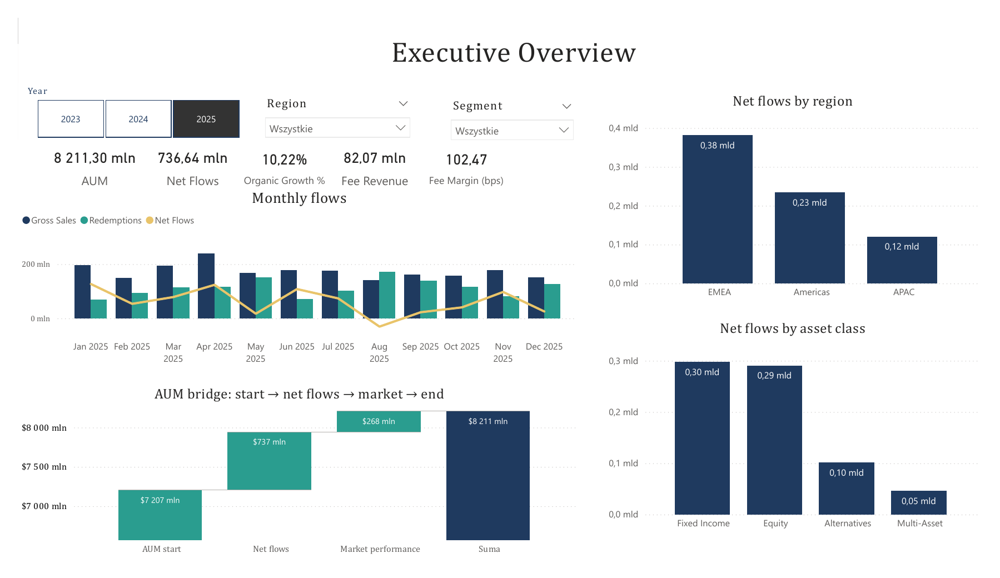
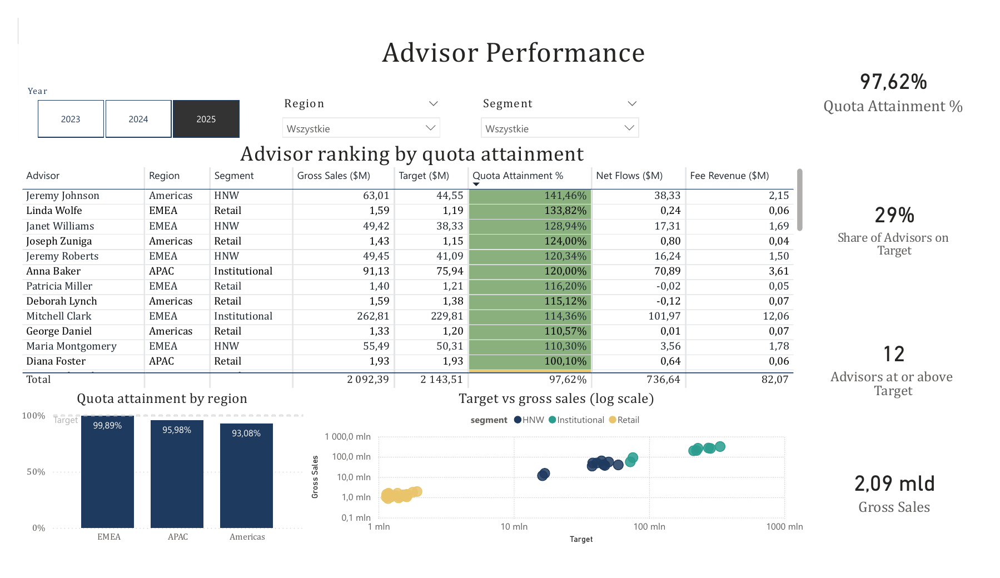
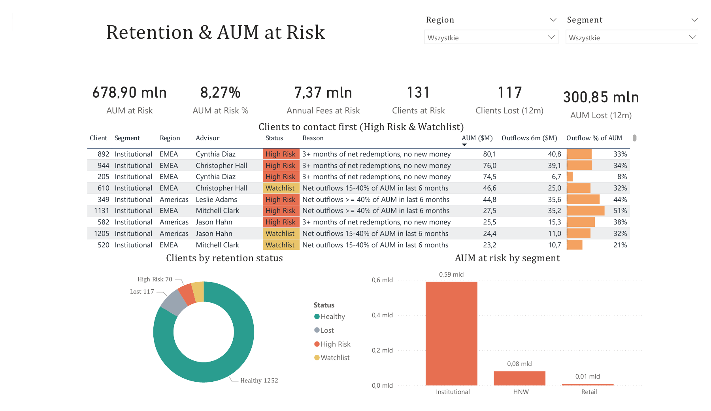

# Asset Management Sales Intelligence

Sales analytics for a fund distribution team: where money comes in and goes out, which advisors
deliver their targets, and which clients are quietly taking their money away.

> **All data is synthetic.** It is generated by `scripts/generate_data.py` with a fixed seed.

## Business problem

In asset management, gross sales alone do not show the health of the business. What matters is
**net flows** (subscriptions minus redemptions), the **fee margin** of the products that are sold
(management fee in basis points of AUM), and early signs of **silent churn**: clients who do not
close their account at once but redeem a bit every month.

The project answers three questions for sales management:

1. Are we growing, and where (region, segment, asset class)?
2. Which advisors are on track to hit their yearly targets?
3. Which clients are at risk of leaving, and how much AUM and fee revenue is at stake?

## Architecture

```mermaid
flowchart LR
    G[generate_data.py<br/>synthetic clients, flows,<br/>fund returns, positions] --> R[(data/raw)]
    G -. --load-mysql .-> DB[(MySQL sales_db<br/>star schema)]
    DB --> V[SQL views<br/>sales, quota, churn signals]
    R --> C[churn_rules.py<br/>churn signals + evaluation]
    C --> P[(data/processed<br/>star schema CSVs)]
    V -. export_to_csv.py .-> P
    P --> BI[Power BI<br/>DAX measures, 3 report pages]
```

## Data model (star schema)

| Table | Grain | Notes |
|---|---|---|
| `Fact_Transactions` | one subscription or redemption | business days only; a redemption never exceeds the holding |
| `Fact_Positions_Monthly` | client × fund × month end | balance after flows and fund return; `fee_usd` = average balance × fee bps / 12 |
| `Fact_Fund_Returns` | fund × month | asset-class return and volatility with a common market factor |
| `Dim_Clients` | client | segment, region, risk profile, relationship manager, churn status |
| `Dim_Advisors` | advisor | every client has one advisor from the same region and segment |
| `Dim_Advisor_Targets` | advisor × year | yearly gross-sales target |
| `Dim_Funds` | fund | asset class and management fee (bps) |
| `Dim_Date` | day | continuous calendar for time intelligence |

## Metric definitions

| Metric | Definition |
|---|---|
| Gross Sales | sum of subscriptions |
| Net Flows | subscriptions − redemptions |
| AUM | month-end market value of all positions |
| Organic Growth | net flows / AUM at the start of the period |
| Market Performance | change in AUM − net flows |
| Fee Revenue | management fees accrued on AUM |
| Fee Margin (bps) | AUM-weighted management fee |
| Quota Attainment | gross sales / yearly target |
| AUM at Risk | current AUM of clients flagged *High Risk* or *Watchlist* |

## Churn rules and how well they work

Rules use rolling windows relative to the last month in the data (`sql/views.sql`,
`scripts/churn_rules.py` — both give identical results):

- **Lost** — AUM now < 10% of the client's 12-month peak
- **High Risk** — net outflows in the last 6 months ≥ 40% of AUM 6 months ago, or 3+ months of
  net redemptions with no new money
- **Watchlist** — net outflows in the last 6 months ≥ 15% of AUM 6 months ago

The generator plants churn in 15% of clients (fast and slow "silent" churn) and adds noise:
10% of loyal clients make one large one-off redemption. The true labels are stored in
`data/ground_truth/` and are **not** used by the dashboard. Evaluation against them:

| Flagged statuses | Precision | Recall |
|---|---|---|
| Lost + High Risk | 0.90 | 0.75 |
| Lost + High Risk + Watchlist | 0.75 | 0.83 |

Most missed churners are slow churners whose outflows stay under the thresholds — the natural
next step is a predictive model that uses the whole redemption history.

## Dashboard

Three pages (`dashboard/AM_Sales_Intelligence.pbix`, DAX in `dashboard/measures.dax`, theme in `dashboard/theme.json`):

1. **Executive Overview** — AUM, net flows, organic growth, fee revenue and margin; AUM bridge
   (start → net flows → market → end); flows by region and asset class.
2. **Advisor Performance** — quota attainment ranking, target vs. gross sales, filters by region
   and segment.
3. **Retention & AUM at Risk** — AUM and annual fees at risk, prioritized list of clients to call
   with the reason for the flag and the responsible advisor.





PDF export: [AM_Sales_Intelligence.pdf](dashboard/AM_Sales_Intelligence.pdf)

## How to run

```bash
pip install -r requirements.txt
python scripts/generate_data.py      # writes data/raw and data/ground_truth
python scripts/churn_rules.py        # evaluates the rules, writes data/processed for Power BI
pytest                               # data quality checks
```

Optional MySQL path: `mysql < sql/schema.sql`, `python scripts/generate_data.py --load-mysql`,
`mysql < sql/views.sql`, `python scripts/export_to_csv.py` (connection settings from
`DB_USER`, `DB_PASSWORD`, `DB_HOST`, `DB_PORT`, `DB_NAME`).

## Limitations

- Synthetic data: patterns are realistic in shape, not calibrated to any real firm.
- Fees are management fees only (no entry fees or performance fees); a single currency (USD).
- Churn status is computed once, as of the last month in the data.
